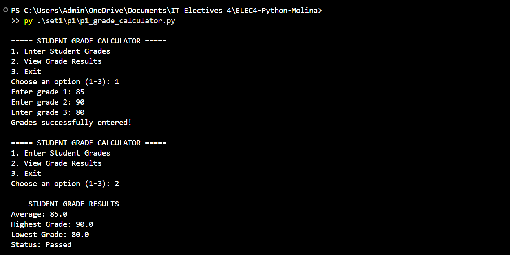
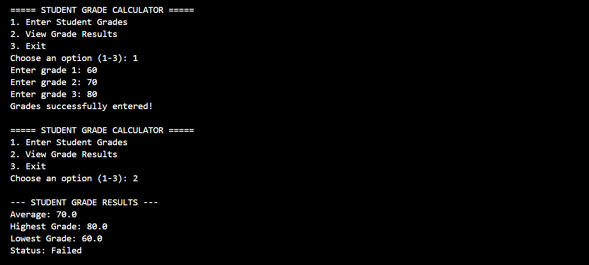
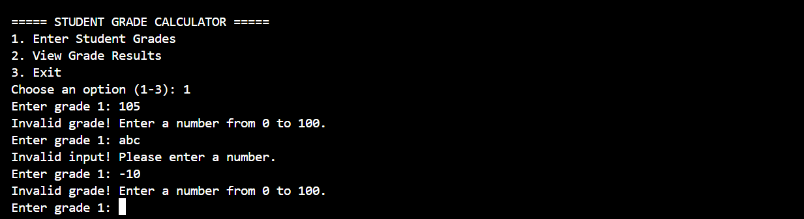
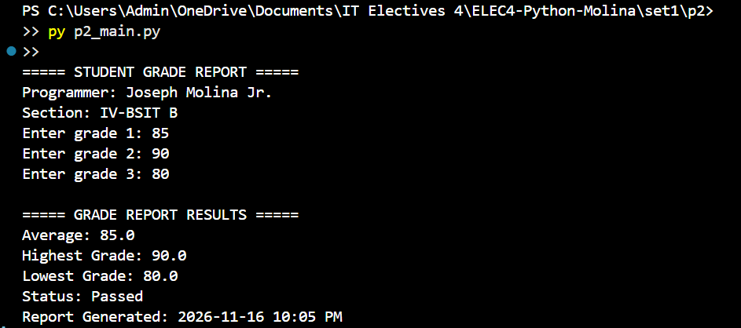
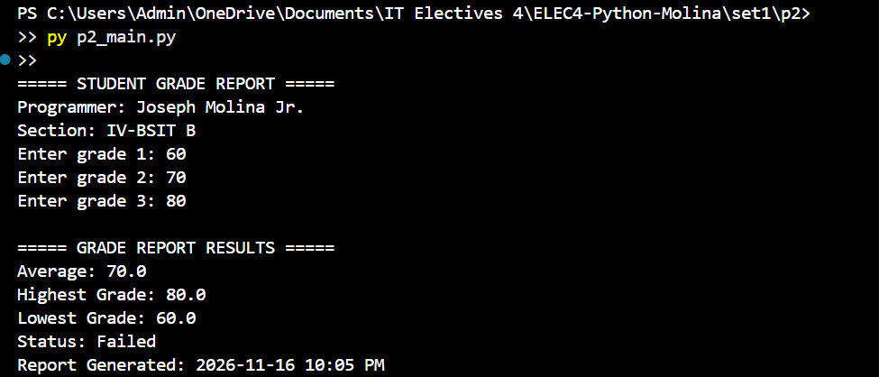
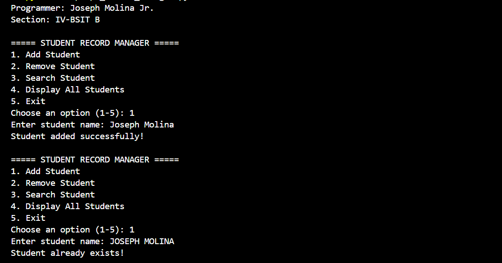
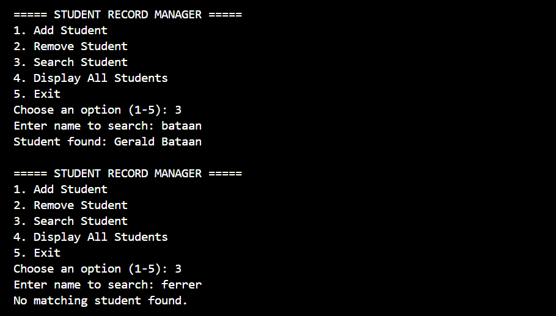
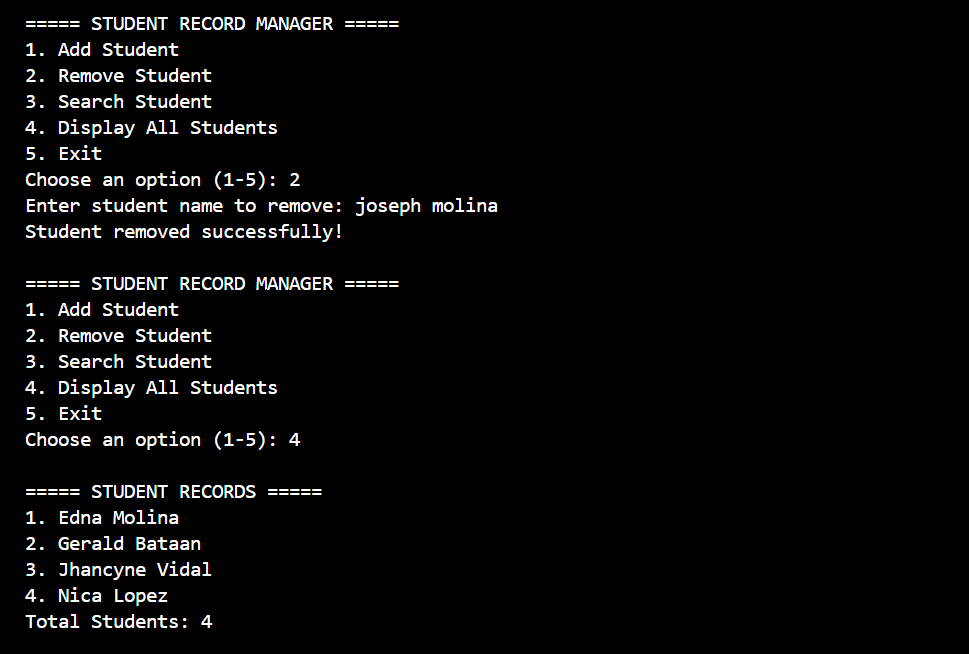

# ELEC 4 - Python Programming

## Student Information
- **Name:** JOSEPH RAMOS MOLINA JR.
- **Section:** IV-BSIT B
- **Course:** ELEC 4 - Python Programming
- **Instructor:** Carl Gustaf Patrik B. Ferrer

## Project Description
This repository contains my individual Python programming activities for ELEC 4.

The activities cover different Python concepts, including functions, modules, lists, sets, exception handling, file handling, recursion, classes, inheritance, and polymorphism.

## Set 1 - Python Basics
- [P1: Student Grade Calculator](set1/p1/) - A menu-driven program that accepts student grades, validates input, calculates the average, highest and lowest grades, and determines pass/fail status.
- [P2: Custom Module - student_utils](set1/p2/) - A Python program that uses a custom module to calculate the average, highest and lowest grades, and pass/fail status. It also uses the built-in datetime module to show when the report was generated.
- [P3: Student Record Manager](set1/p3/) - A menu-driven Python program that uses lists and sets to add, remove, search, and display student names while preventing duplicate entries.

- P4: Safe Menu Program

## Set 2 - Advanced Python
- P5: Student Information File System
- P6: Recursion Toolkit
- P7: Student Management System with Classes
- P8: Inheritance and Polymorphism


## How to Run the Programs

### P1 - Student Grade Calculator

1. Make sure Python is installed.
2. Open a terminal in the repository's root folder.
3. Run the following command:

```powershell
py set1/p1/p1_grade_calculator.py
```

4. Select an option from the menu:
   - 1 - Enter Student Grades
   - 2 - View Grade Results
   - 3 - Exit


### P2 - Custom Module: student_utils

1. Make sure Python is installed.
2. Open a terminal in the repository's root folder.
3. Run the following command:

```powershell
py set1/p2/p2_main.py
```

4. Enter three student grades when prompted.
5. The program will display the average, highest grade, lowest grade, pass/fail status, and date and time the report was generated.

**Files used:**
- `student_utils.py` - Contains the four reusable grade calculation functions.
- `p2_main.py` - Accepts user input, imports the functions, and displays the grade report.


### P3 - Student Record Manager

1. Make sure Python is installed.
2. Open a terminal in the repository's root folder.
3. Run the following command:

```powershell
py set1/p3/p3_record_manager.py
```

4. Choose an option from the menu:
   - 1 - Add Student
   - 2 - Remove Student
   - 3 - Search Student
   - 4 - Display All Students
   - 5 - Exit

The program stores student names in a list and uses a set to prevent duplicate entries. It supports case-insensitive name checking, partial-name searching, and alphabetical display of students.


## Screenshots

### P1 - Student Grade Calculator

**Passing Result**



**Failing Result**



**Input Validation**



### P2 - Custom Module: student_utils

**Passing Result**



**Failing Result**



### P3 - Student Record Manager

**Adding Students and Duplicate Prevention**



**Searching Student Records**



**Removing and Displaying Student Records**




